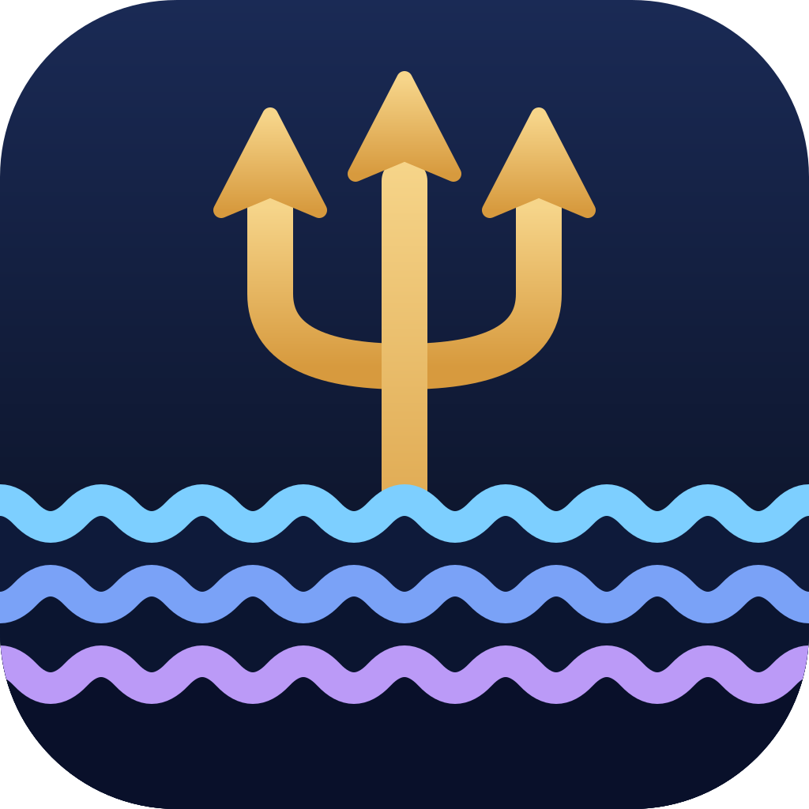
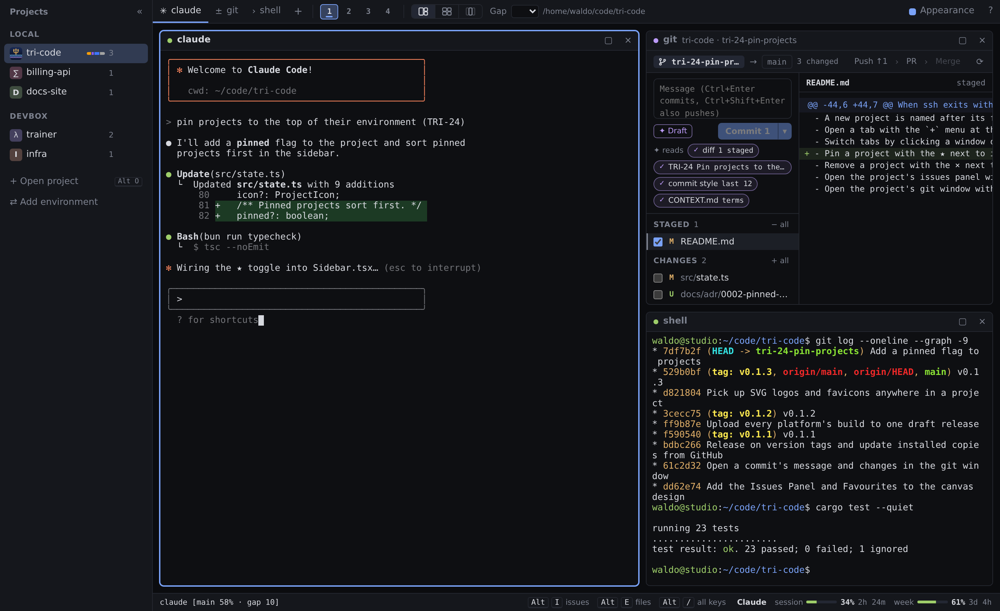
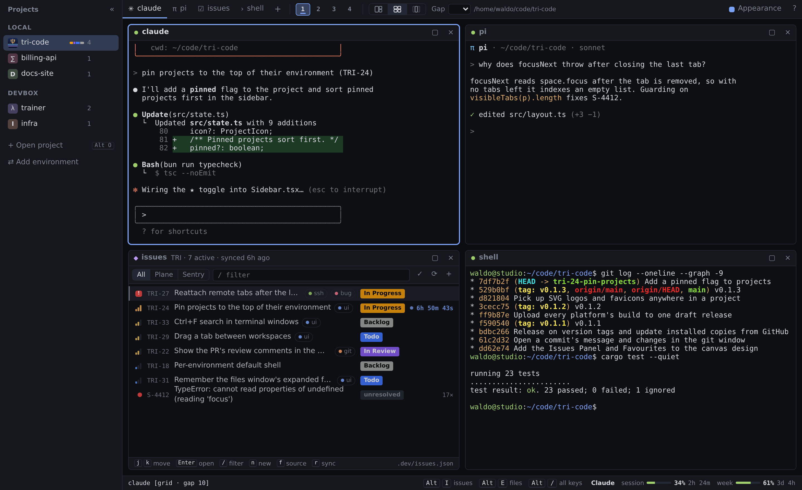
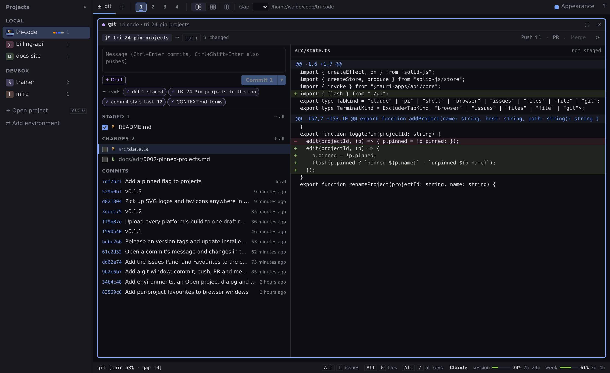
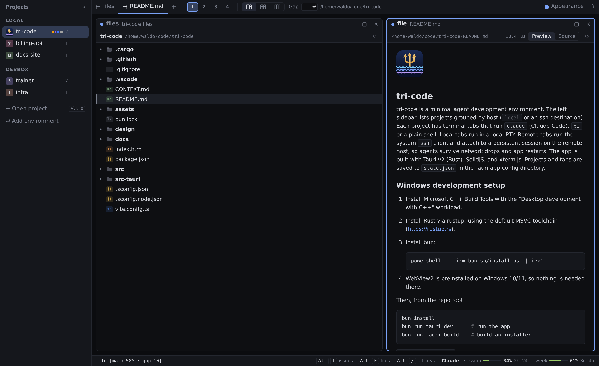
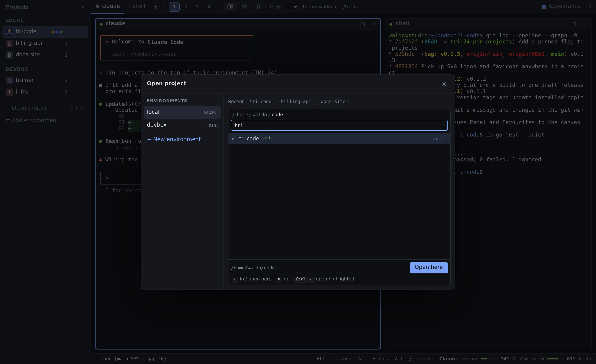

# tri-code

tri-code is a minimal agent development environment. The left sidebar lists projects grouped by host (`local` or an ssh destination). Each project has terminal tabs that run `claude` (Claude Code), `pi`, or a plain shell. Local tabs run in a local PTY. Remote tabs run the system `ssh` client and attach to a persistent session on the remote host, so agents survive network drops and app restarts. The app is built with Tauri v2 (Rust), SolidJS, and xterm.js. Projects and tabs are saved to `state.json` in the Tauri app config directory.



## Screenshots

**Agents side by side.** claude, pi, the issues panel and a shell tiled in the grid layout. The sidebar groups projects by environment, local or ssh.



**Git window.** Stage files, read the diff, browse recent commits, and draft the commit message with ✦ from the diff, the In Progress issue and the commit style.



**Files window.** Browse the project folder and preview Markdown and HTML.



**Open project.** Pick an environment, then type to filter folders. Git repositories are marked.



## Windows development setup

1. Install Microsoft C++ Build Tools with the "Desktop development with C++" workload.
2. Install Rust via rustup, using the default MSVC toolchain (https://rustup.rs).
3. Install bun:

   ```
   powershell -c "irm bun.sh/install.ps1 | iex"
   ```

4. WebView2 is preinstalled on Windows 10/11, so nothing is needed there.

Then, from the repo root:

```
bun install
bun run tauri dev      # run the app
bun run tauri build    # build an installer
```

`.cargo/config.toml` caps build jobs at 2 so builds fit on low-RAM machines. To raise the cap, set `CARGO_BUILD_JOBS`, for example in PowerShell: `$env:CARGO_BUILD_JOBS=8; bun run tauri build`.

## Remote hosts

A remote project needs the following on the remote machine:

- Key-based ssh that works non-interactively from the Windows OpenSSH client. `ssh <host>` must not prompt for a password or passphrase. An alias from `~/.ssh/config` works as the host.
- shpool, the preferred session backend: `cargo install shpool`.
- tmux as a fallback if shpool is not installed. If neither is installed, the tab runs the command directly and does not survive disconnects.
- `claude` and/or `pi` on the PATH of the login shell (`$SHELL -l`). Commands run through the login shell, so PATH must be set in its startup files.

When ssh exits with code 255 (connection failure), the tab reconnects automatically. The retry delay starts at 1s and doubles up to 10s. Closing a remote tab also ends its remote session.

## Usage

- The sidebar groups projects by environment: `local`, or an ssh destination. Add one with "⇄ Add environment": pick an alias from `~/.ssh/config` or type `user@host`. The connection is tested before the environment is added (remote hosts are listed over ssh, so key auth must work).
- Open a project with "+ Open project" or `Alt+O` (or the `+` on an environment's header). Pick the environment on the left and the folder on the right. Type to filter the folder list; `Enter` goes into the highlighted folder, or opens the folder you are in when the filter is empty; `Backspace` on an empty filter goes up; `Ctrl+Enter` opens the highlighted folder; a path starting with `~` or `/` jumps there. Git repositories are marked. Recent folders for the environment are listed above the picker.
- A new project is named after its folder and gets its icon from a logo file in it (`logo.svg`, `favicon.*`, `public/…`, `assets/…`, `src-tauri/icons/icon.png` and similar, with any SVG or favicon named logo/icon/brand/mark found up to four folders deep), or its first letter. Rename it by double-clicking its name, or in the Appearance panel (◐ or `Alt+P`), which also overrides the icon: another logo from the project, an uploaded image, a glyph or the letter.
- Open a tab with the `+` menu at the left of the toolbar; `Issues` and `Files` open their one-per-project window instead of adding a second. `Alt+Enter` opens another window of the focused kind, `Alt+B` a browser, `Alt+I` issues, `Alt+E` files. On Windows, local `claude` and `pi` tabs run through `cmd.exe /d /c`, and shell tabs run `powershell.exe`.
- Switch tabs by clicking a window or its tab in the toolbar. Close the focused tab with its × or `Alt+Q`: it disappears right away behind a 5-second Undo, and a running tab's session ends only when the undo window closes.
- Remove a project with the × next to it in the sidebar. This closes all of its tabs. The × on an environment's header removes it with all its projects.
- Open the project's issues panel with Alt+I (or `+` → issues). It renders the project's `.dev/` folder: Plane work items and States pulled from Plane, plus any Sentry items pi-todos has pulled. It is the same data pi-todos and dev-hub use, and it writes the same `issues.json`, `plane-states.json` and `plane-labels.json`, so the three always agree. A remote project's `.dev/` is read and written over ssh. Plain keys drive the panel while it is focused (`j`/`k`, `Enter`, `Esc`, `d` state, `l` labels, `s` timer, `n` new, `r` sync, `/` filter).
- Open the project's git window with `Alt+C` (or `+` → git). The left side is the commit box and the staged and unstaged files (tick a file to stage it, double-click to open it), then the recent commits: click one to read it in the right pane, its message on top and its changes below. The right side otherwise shows the selected file's diff. `Ctrl+Enter` in the message commits and `Ctrl+Shift+Enter` commits and pushes; the ▾ next to Commit also has "Commit, push & open PR". Push, PR and Merge in the header open a drawer over the diff; the open PR's checks refresh every 15s while they run. It needs `git` on the project's host, and `gh` (logged in) for PRs and merging.
- The ✦ buttons in the git window write a draft for you to edit: the commit message, the PR title and body, and a review of the whole branch before merging. They run `claude -p` in the project folder on the project's host, so they use your own Claude Code login. The chips under "✦ reads" are what the draft is given: the diff, the In Progress issue (the one named in the branch, else the first), the last commit subjects (for the style) and `CONTEXT.md`. Click one to leave it out. "Send to claude" on a review note types it into the project's claude or pi window without sending it.
- Tab dots show the status: connecting, running, reconnecting, or exited. Press Enter in an exited tab to restart it.
- Ctrl+C copies the terminal selection and still sends SIGINT when nothing is selected; Ctrl+V pastes. Full-screen apps such as claude and pi capture the mouse, so hold Shift while dragging to select their text. To make a plain drag select in Claude Code's fullscreen mode, set `CLAUDE_CODE_DISABLE_MOUSE=1` (it then scrolls with PgUp/PgDn instead of the wheel).
- A tab that rings the terminal bell while it is hidden is flagged, and its project shows a badge in the sidebar. To get this from Claude Code, set its notification channel to the terminal bell in Claude Code's `/config` (notifications setting).

## Releases and updates

Pushing a `v*` tag runs `.github/workflows/release.yml`, which builds the Windows installers (NSIS and MSI) and the macOS apps (Apple Silicon and Intel), signs the update bundles, and publishes them as a GitHub Release. The version lives only in `package.json`; `tauri.conf.json` reads it from there.

```
bun pm version patch          # or minor, major, or 1.2.3; commits and tags v<version>
git push --follow-tags
```

Installed copies check the latest release's `latest.json` at startup and every 6 hours, download a newer version in the background, and show "↻ Restart to update" in the status bar. Restarting ends local terminal sessions; remote tabs reattach. Dev builds never update.

The updater checks downloads against the public key in `tauri.conf.json`. The matching private key is the `TAURI_SIGNING_PRIVATE_KEY` repository secret (kept outside the repo at `~/.tauri/tri-code.key` on the machine that made it). If the key is lost, installed copies cannot verify new releases and must be reinstalled by hand. The macOS builds are not notarized, so Gatekeeper blocks the first launch: right-click the app and choose Open.

## Development

Rust tests:

```
cd src-tauri && cargo test
```

The SSH end-to-end test is ignored by default. It needs passwordless ssh and shpool on the target host, and it only runs on Unix:

```
TRI_SSH_HOST=<host> cargo test -- --ignored
```

Frontend checks: `bun run typecheck` for TypeScript and `bun run build` for a Vite build.

Layout:

`src/`

- `index.tsx`: entry point. Mounts the app and loads the xterm and app stylesheets.
- `App.tsx`: sidebar, tab bar, terminal host.
- `Sidebar.tsx`: projects grouped by environment, rename in place.
- `OpenProject.tsx`: the Open project dialog (`Alt+O`): environments, the folder picker, and the New environment form.
- `icons.tsx`: project icons: logo scan, auto pick, upload, and the icon face drawn in the sidebar.
- `Appearance.tsx`: the Appearance panel: name, icon, accent, background, dim.
- `state.ts`: Solid stores for projects, tabs, and live tab status. Loads and debounced-saves the state file.
- `terms.ts`: one xterm and one PTY per tab. Handles output, resize, reconnect backoff, bell detection, and the WebGL renderer for the visible tab only.
- `issues.ts`: the `.dev/` store and Plane sync, plus the pure helpers (sort order, State Pill contrast, Slug-ID).
- `IssuesPanel.tsx`: the issues window: the list, the full-width drill-down, the State Dropdown, labels, and the comment thread.
- `updater.ts`: the update check, background download, and "Restart to update".
- `styles.css`: application styles.
- `vite-env.d.ts`: Vite type declarations.

`src-tauri/src/`

- `main.rs`: binary entry point. Hides the console window in Windows release builds.
- `lib.rs`: Tauri setup. Registers the commands and the shared PTY state.
- `dirs.rs`: folder listing for the project picker (marking git repositories), local or over ssh.
- `envs.rs`: `ssh_hosts` (the `Host` aliases in `~/.ssh/config`) and `scan_logos` (logo files in a project folder, as data URLs), local or over ssh.
- `bg.rs`: background and icon images, stored as data URL files next to `state.json`.
- `devfs.rs`: `dev_read` / `dev_write` for a project's `.dev/` folder, local or over ssh, with an atomic write.
- `plane.rs`: the Plane.so REST calls the issues panel needs (sync, set state, set labels, create, comments, asset upload). The token is read from `~/.pi/agent/secrets/plane.json` on the project's host.
- `remote.rs`: the shared non-interactive ssh command builder used by `dirs.rs`, `envs.rs` and `devfs.rs`.
- `pty.rs`: PTY sessions (spawn, output channel, write, resize, kill) and remote session cleanup.
- `spawn.rs`: builds the program and arguments for local and ssh tabs, including the shpool and tmux fallback. Contains the unit tests and the ignored SSH end-to-end test.
- `store.rs`: loads and atomically saves `state.json`.
